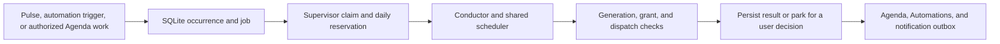

# Proactive Assistant Runtime

Aria opens into ordinary chat. Agenda tracks responsibilities for the local desktop profile. Automations owns triggers and recurrence. Pulse periodically gives the configured primary an opportunity to review those responsibilities. All three use Conductor and the shared capability registry, scheduler, and dispatch journal.

## Using proactive work

- In **Agenda**, create an objective or task, set its prerequisites, and choose **Run task** to review execution permissions. A prerequisite counts as satisfied after verified completion or explicit user completion. Jobs show attempts, activity, and verified results. Use **Save finding to memory** to review a completed result through the existing Memory approval flow.
- In **Automations**, create a schedule directly or choose **Describe in chat**. Natural-language proposals display the original instruction separately from the proposed action. Review the trigger, scope, and limits before authorizing. The run history records what actually happened.
- In **Settings → Proactive Assistant**, enable and configure Pulse, optionally keep Aria running when the window closes, and set quiet hours, notifications, limits, and retention. Pulse starts off. Manual Pulse bypasses cadence and activity filters and observes pause and budget limits.
- Use the tray or app menu to **Quit Aria**. Background jobs require an awake computer and a running Aria process. Packaged macOS and Windows expose OS launch at login through the existing desktop settings. Locked-screen notifications display generic text.

## Ownership and execution

Electron main opens one supervisor for the local profile. It passes a typed job origin through the token-authenticated managed loopback endpoint into the existing Conductor loop. Job IDs occupy the scope slots in the shared transport and journal. They identify durable jobs and never create a chat conversation or a user message. A submitted clarification keeps its user role. Background runs use the primary selected in Settings and leave one Conductor turn and provider slot available for foreground work.

SQLite v9 adds the proactive domain to the existing runtime database. Objectives, tasks, dependencies, and automation definitions have separate lifecycles. Jobs own numbered attempts, worker leases, checkpoints, and receipt references. Foreground chat checkpoints continue to use their existing shorter lifetime. Job history defaults to 30 days. Incomplete responsibilities and unresolved effects retain their state. Upgrading is transactional. Older v8 builds need a matching pre-upgrade backup.

Claims run under a SQLite write transaction. A random fence and monotonic execution generation identify each claim. Workers renew a 30-second lease every five seconds. Main verifies the fence at scoped dispatch and result commit. A crashed or suspended attempt is reconciled against the shared dispatch journal. Safe continuations reuse encrypted checkpoint metadata and receipts. An interrupted operation that might have changed an external system stays available for user review.

The supervisor wakes at the next indexed due time, on mutation, on service readiness, and on OS lifecycle events. A bounded clock check catches wall-clock and time zone changes. Configuration, worker liveness, and retry scheduling are deterministic. The model decides how to carry out the responsibility and when its answer needs clarification or verification.

## Schedules and limits

Intervals advance from a saved absolute anchor. Daily, weekly, monthly, and five-field cron schedules use a selected IANA time zone. Follow-system schedules recompute on zone change. Calendar gaps and nonexistent monthly dates are skipped. A repeated wall time fires once at the earlier instant. For a one-time repeated local time, enter an explicit UTC offset.

After sleep or downtime, the saved missed-run policy applies. The default runs the latest eligible missed occurrence once. Skip advances the cursor without execution. Catch-up selects up to three recent occurrences. Intentional automation pause and emergency pause suppress new occurrences. An occurrence key prevents duplicate jobs across restarts. Task completion and dependency readiness use trusted committed events. Runtime resume and desktop unlock are the supported desktop events.

Conditional runs use registered browser and web reads. Main accepts a reported condition after a verified observation of the configured origin. The first verified result establishes the baseline. A transition can emit a notification after the configured cooldown. Unknown results and errors preserve the last verified value.

The scheduler reserves daily token and monetary limits before admitting paid work. Defaults are 200,000 input tokens, 32,000 output tokens, and $1 per UTC day. Per-run limits can be narrower. Missing verified pricing blocks paid runs and surfaces a configuration error. One background job may execute by default, with two as the maximum. Retries are capped and do not replay an uncertain effect. Attempts report model requests, duration, tokens, and accounted or conservatively reserved cost.

## Permission and privacy boundaries

A review binds a grant to the configured primary, credential identity, capability scope, expiration, and record revision. A subsequent model or credential change requires renewed review of affected responsibilities. Every consequential browser operation pauses for approval of its exact target and action. Approval covers a single matching dispatch after fresh observation. A changed target or input requires a new approval. Capabilities that require an interactive environment outside the supported job scope remain unavailable to background work.

Main uses OS-backed encryption for instructions, approvals, results, and checkpoints. The model has no arbitrary database or scheduling access. Memory recall requires a scoped grant and the existing primary consent, and returns only selected profile entries. Recalled private content prevents outbound web dispatch. Deleting the source conversation clears pending chat-derived proposals. Independently reviewed responsibilities retain the approved copy. Memory invalidation clears affected result and checkpoint projections. Verified public job findings can be saved with explicit approval and job provenance.

IPC exposes validated commands and sequenced change events through the existing preload bridge. Renderer screens reload committed projections. Native notifications have separate delivery state, apply quiet hours and local preferences, and open the corresponding Agenda record or automation.

## Verification

Run `pnpm typecheck`, `pnpm lint`, `pnpm test`, `pnpm build`, `pnpm test:electron`, and `pnpm licenses:check`. Desktop tests use isolated SQLite profiles, controlled clocks, and a local deterministic HTTPS provider for priced background execution. Run the built suite on Apple Silicon and Windows before packaging. Verify native notifications, login, shutdown, suspend, and resume on each supported OS. Standalone API and Live Voice continue to use their existing execution entry points.

